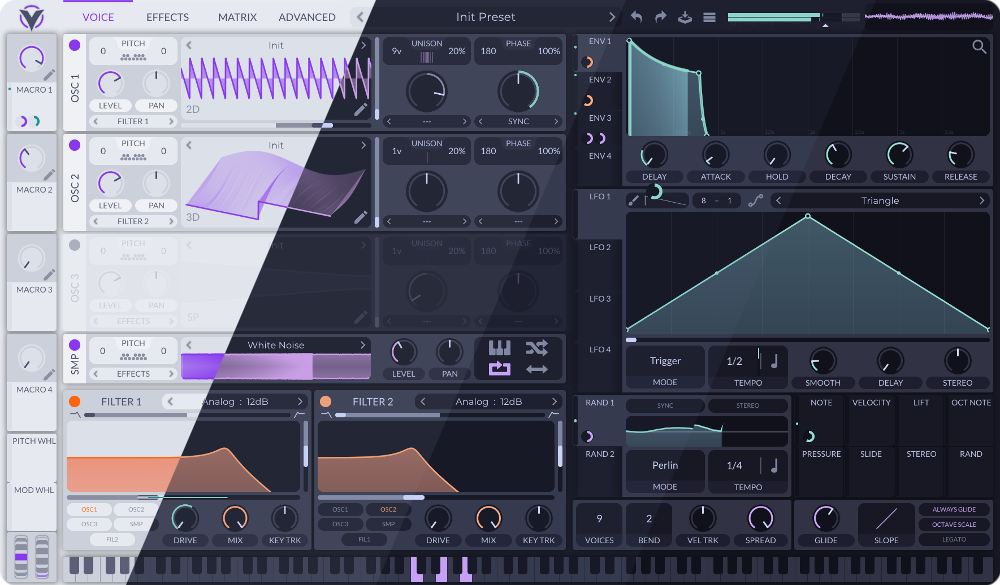
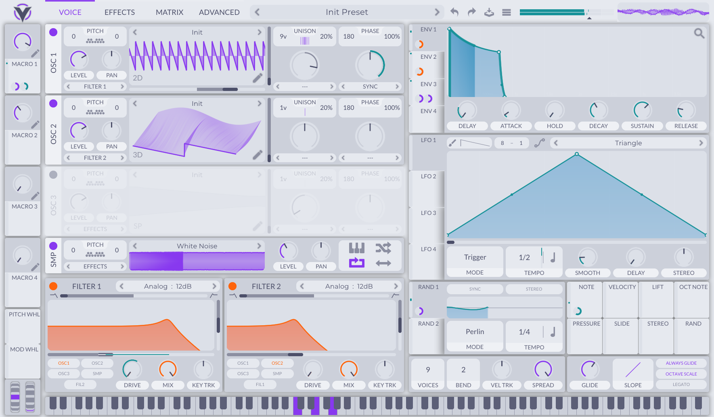
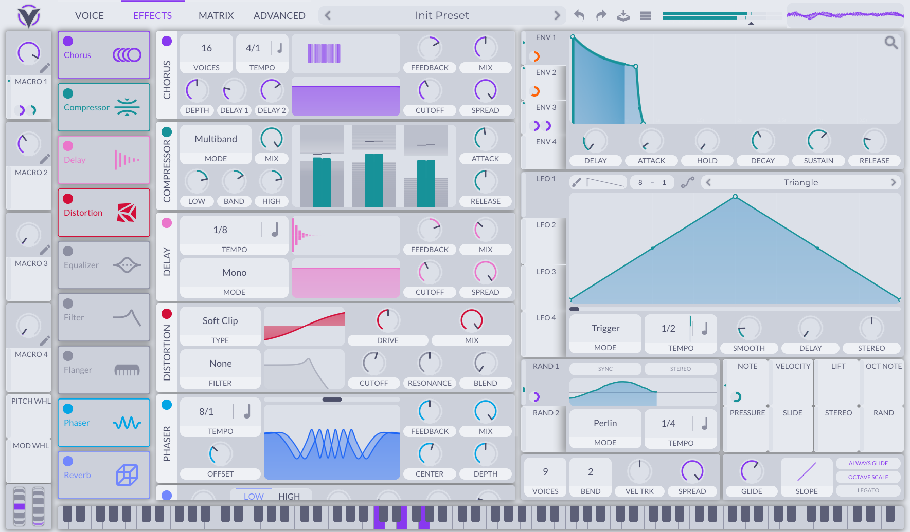
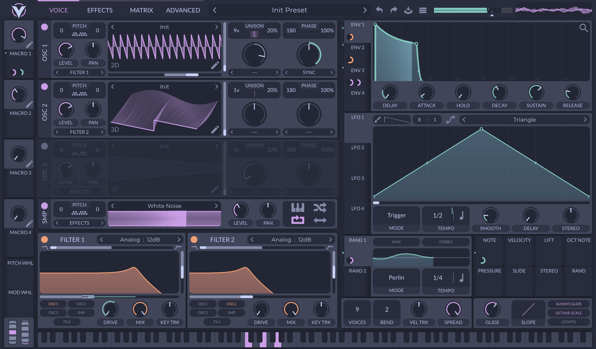
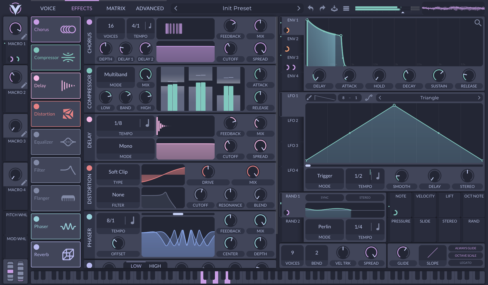
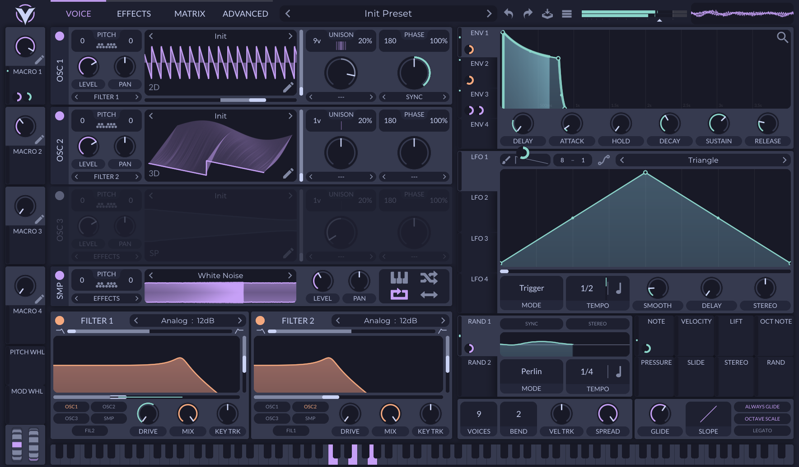
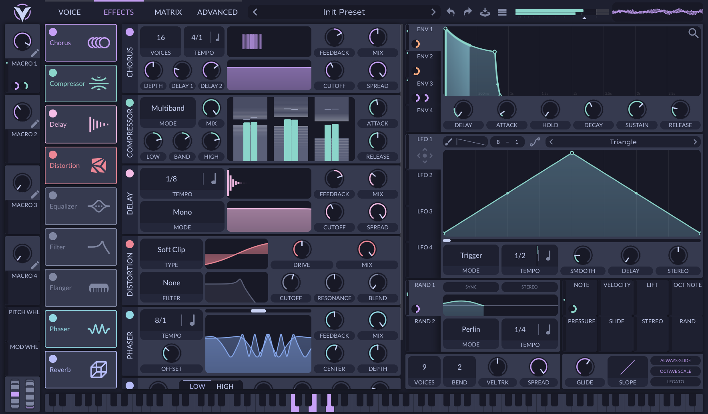
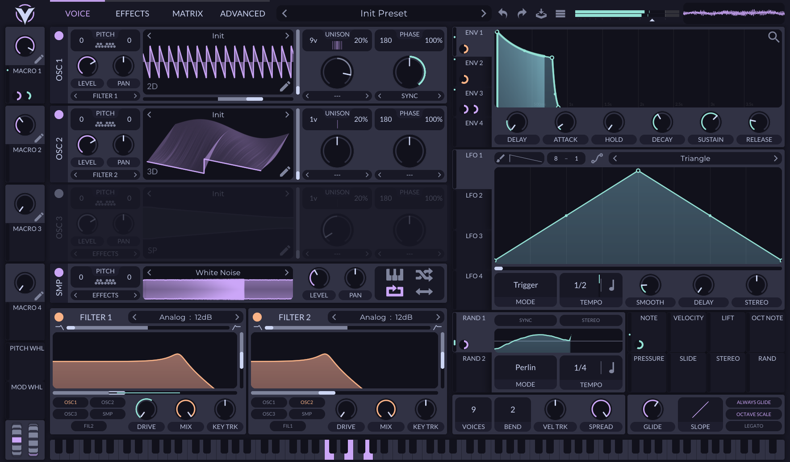
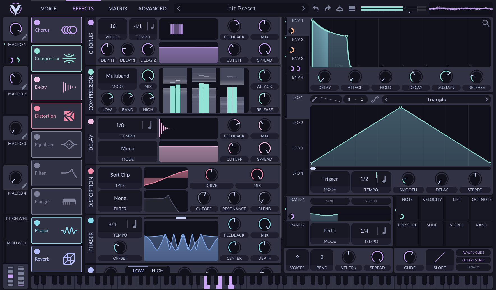

<h3 align="center">
	 
	
	Catppuccin for <a href="https://vital.audio/">Vital</a>
	
</h3>

	
	
	

	

## Previews

🌻 Latte

🪴 Frappé

🌺 Macchiato

🌿 Mocha

## Usage

1. Download the flavor of your choice.
2. Open Vital and go to **Advanced** > **Display** > **Theme** > **Load Custom Theme**.
3. Select the downloaded flavor file.

## 💝 Thanks to

  - [NekomiKagurazo](https://github.com/xenone1100)

&nbsp;

	

	Copyright &copy; 2021-present <a href="https://github.com/catppuccin" target="_blank">Catppuccin Org</a>

	

